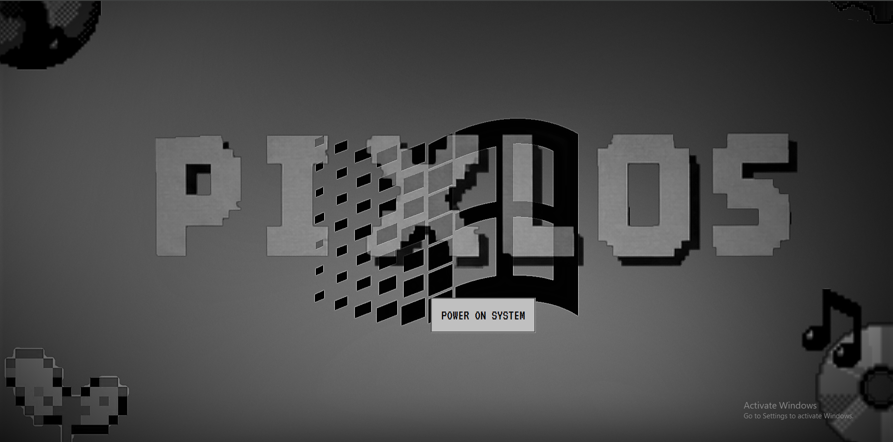
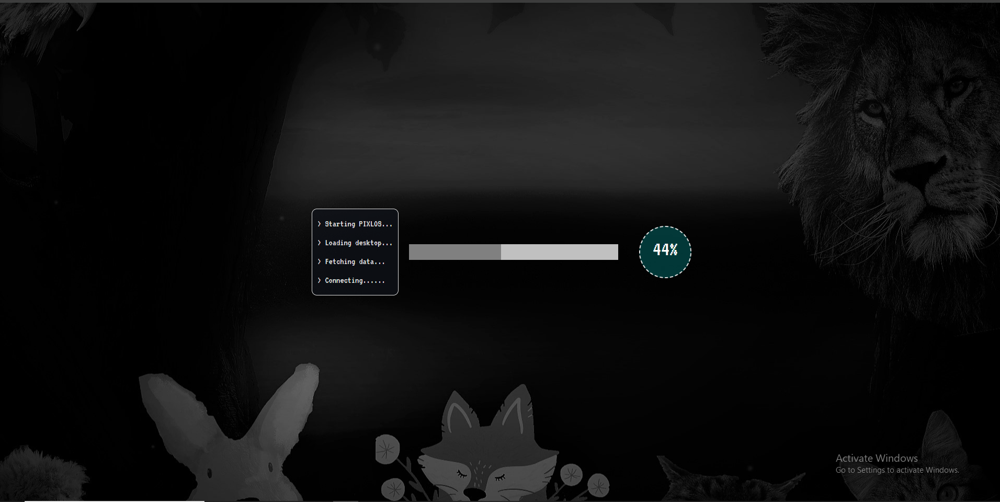
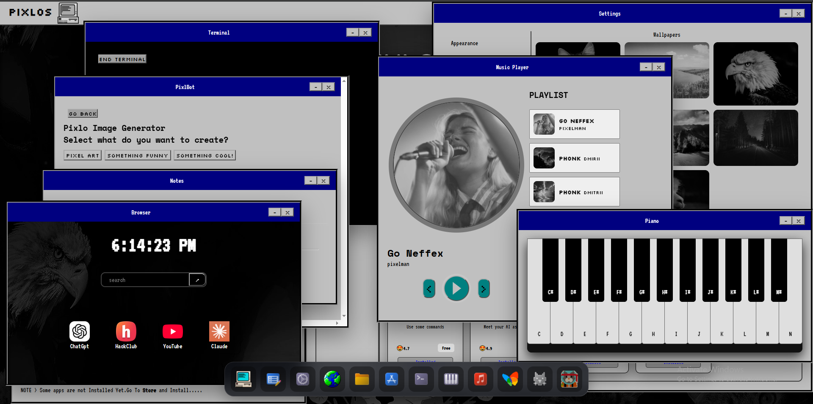
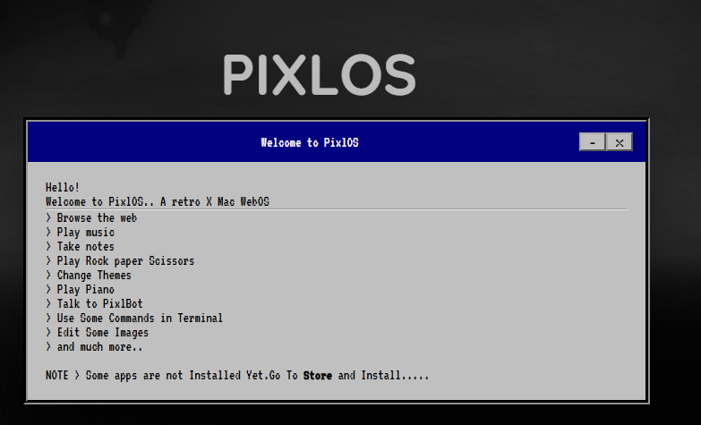

# PixlOS

PixlOS is a Retro X Mac-themed webOS that runs in your browser. You can explore, play games, browse, listen to music and try out different applications. There's a lot to discover! Some Application's did't install yet so go to store and install..

## Preview









## Live Demo

**[ PixlOS link](YOUR)**

## Features

- Retro X Mac-themed desktop.
- Draggable application windows.
- Open and close application windows.
- Real-time clock.
- Custom boot animation.
- Animated boot progress bar with an increasing percentage counter.
- Multiple built-in applications.
- Music player.
- Rock paper Scissors game.

## Applications

I built different applications for the desktop so there's more to do than just look around.

- **File Manager** – Browse and manage files inside PixlOS.
- **Notes** – Write down anything.
- **Pixel AI** – My built-in AI assistant interface.
- **Terminal** – A terminal-style application.
- **Settings** – Change some settings.
- **Image Editor** – edit images.
- **Music Player** – Play music and chill.
- **Piano** – A polished virtual piano built using HTML, CSS and JavaScript.
- **Store** – An App Store-style place to explore applications and download.
- **Game** – Play game inside PixlOS, including Rock Paper Scissors.

## Boot Animation

The boot animation is one of my favourite parts of PixlOS.

I created a custom image for the boot background and spent quite a bit of time getting it the way I wanted. I also added animations to the boot screen, including the progress bar and the percentage counter that increases as the system boots.

It's a small part of the project, but I'm really happy with how it turned out.

## Technologies Used

- HTML
- CSS
- JavaScript

## How to Run Locally

1. Clone the repository:

   ```bash
   git clone https://github.com/RaphelReji/PixlOS.git
   ```

2. Open the PixlOS folder in VS Code or another code editor.

3. Open `index.html` in your browser.

That's it! PixlOS runs in your browser.

## Development

PixlOS is built with:

- An `index.html` file containing 1,500+ lines.
- 7–8 JavaScript files.
- A CSS file containing 1,000+ lines.

I worked on the desktop, applications, animations and different parts of the interface to bring everything together into one web-based desktop environment.

## Credits & Acknowledgements

- **Pixl YSWS – Hack Club:** Inspiration and name for the project.
- **Hack Club WebOS jam Guide:** Used as a guide during development.
- **WildOS:** My previous project, which I used as a starting reference.
- **Pixabay:** Music resources used in the project.
- **OldPCIcons:** Icons used in the project.
- **Icons8:** Additional icon resources.
- **Google:** Used as a reference while building the Piano application.

Third-party assets belong to their respective creators and owners.

---

Thanks for checking out ****PIXLOS****.
