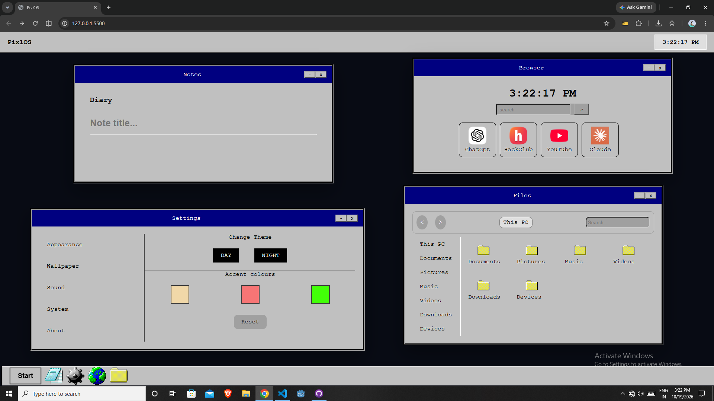

# PixlOS

Welcome to my README.Here i am explaining the idea,the features,how everything works and the resources i used in this project.

## About PixlOS

This is a web based OS called ***PIXLOS***.I made this WebOS for Hackclub  WebOS jam. It is fully retro themed and have some owesome features.This one is web playable so anyone can test it.I added **4 apps** in that you can change background etc.. way more .Its very interesting to build and learn .check it out and  if you have any suggestions feel free to tell. 

## Live Demo

[Open the live website]()

## Features

* Desktop environment
* Draggable app windows
* 3 working apps
* Clock
* Custom backgrounds
* Appearance settings
* Retro-themed interface

## Screenshots




## The Apps

###  Notes

The Notes app is a simple app to write notes.
Its a simple app blended with retro theme.just try it out its the first app!

###  Settings

The Settings app is a app to change the theme,appearance , wallpaper and more.

###  Browser

Browser is a app featuring a search bar and 4 card with real clock on that.


###  Files

 The file app is normal windows file explorer but it was in v1.


## Installation to run locally

1. Clone this repository:
```bash
git clone https://github.com/RaphelReji/WildOS.git
```
Repository url:
```bash
git clone https://github.com/RaphelReji/WildOS
```

2. Open the project folder in VS Code or any code editor.

3. Open `index.html` in your browser.

### How It Works
You want to explore like a nornal OS, customise the theme etc.... .

## Design
 just pure retro themed one . 


## Resources
* WebOS mission resources
* Other webos projects references

## Credits 

 - I used pixbay to likely take everything
 - images belong to the rightful owner
 - icons:Taken from icon8 and oldpcicons

 ## License

This project was created under MIT-do what ever with it.

Thanks for checking out ****PIXLOS****.
